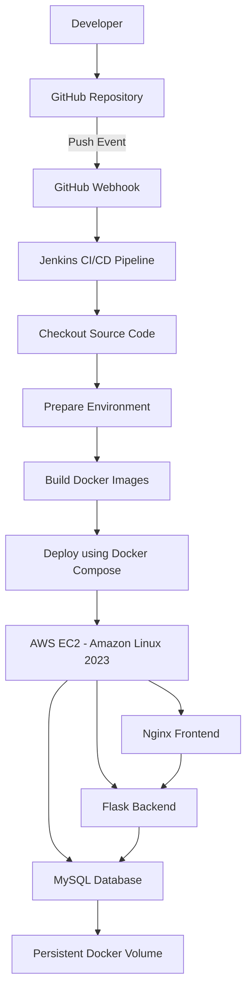

# Two-Tier Task Manager – Docker & Jenkins CI/CD on AWS

## Project Overview

A two-tier web application deployed on AWS EC2 using Docker containerization and Jenkins CI/CD automation.

The application allows users to create, view, update, and delete tasks. GitHub Webhooks automatically trigger Jenkins pipelines whenever code is pushed to the repository.

## Architecture



## Technologies Used

| Category | Technology |
|---|---|
| Cloud | AWS EC2 |
| Operating System | Amazon Linux 2023 |
| Version Control | Git & GitHub |
| CI/CD | Jenkins |
| Containerization | Docker |
| Orchestration | Docker Compose |
| Frontend | HTML, CSS, JavaScript, Nginx |
| Backend | Python Flask |
| Database | MySQL 8.4 |

## Project Structure

```text
two-tier-app/
├── backend/
├── frontend/
│   ├── Dockerfile
│   ├── index.html
│   ├── nginx.conf
│   ├── script.js
│   └── style.css
├── database/
│   └── init.sql
├── Jenkinsfile
├── docker-compose.yml
├── .env.example
├── .gitignore
└── README.md
```

## Application Features

- Create new tasks.
- Display existing tasks.
- Update task status.
- Delete tasks.
- Store task information in MySQL.
- Persistent database storage using Docker volumes.

## CI/CD Workflow

The project uses GitHub Webhooks to automate deployment.

1. Developer pushes code to GitHub.
2. GitHub Webhook triggers Jenkins.
3. Jenkins checks out the latest source code.
4. Environment configuration is prepared.
5. Docker images are built.
6. Docker Compose deploys the application.
7. Container status is verified.
8. Application health check is performed.
9. Jenkins reports pipeline success or failure.

## Jenkins Pipeline Stages

| Stage | Description |
|---|---|
| Checkout | Retrieves source code from GitHub |
| Prepare Environment | Copies environment configuration |
| Build Docker Images | Builds application images |
| Deploy Application | Starts containers using Docker Compose |
| Verify Containers | Checks running container status |
| Application Health Check | Checks frontend HTTP availability |

## Deployment Instructions

### Prerequisites

- AWS EC2 instance running Amazon Linux 2023.
- Docker installed.
- Docker Compose plugin installed.
- Git installed.
- Jenkins installed and configured.
- GitHub repository access.

### 1. Clone the repository

```bash
git clone <YOUR_REPOSITORY_URL>
cd two_tier_docker_jenkins
```

### 2. Configure environment variables

```bash
cp .env.example .env
vi .env
```

Configure the required MySQL environment variables.

Never commit `.env` or expose database credentials.

### 3. Build and deploy

```bash
docker compose -p two-tier-app up -d --build
```

### 4. Verify containers

```bash
docker compose -p two-tier-app ps
```

### 5. Access the application

Open the EC2 public IP in your browser:

```text
http://<EC2-PUBLIC-IP>
```

## Useful Docker Commands

Check running containers:

```bash
docker ps
```

View application logs:

```bash
docker compose -p two-tier-app logs
```

View backend logs:

```bash
docker compose -p two-tier-app logs backend
```

Stop the application:

```bash
docker compose -p two-tier-app down
```

Start the application:

```bash
docker compose -p two-tier-app up -d
```

## CI/CD Automation

A GitHub Webhook is configured to trigger the Jenkins pipeline on every push event.

This enables automated application deployment without manually starting each Jenkins build.

## Project Outcome

Successfully deployed a containerized two-tier application on AWS EC2 with:

- Docker-based application isolation.
- MySQL persistent storage.
- GitHub source code management.
- Jenkins automated CI/CD pipeline.
- GitHub Webhook integration.
- Automated deployment and frontend health verification.

